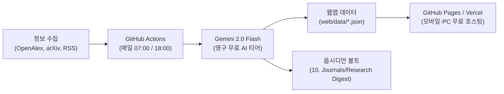

# 🍵 고요한 연구 살롱 (Research Digest & Archive Web App)

> **비판적 생태·기술 커먼즈, 시빅 HCI/UXR, 농생태학 연구자를 위한 100% 영구 무료 자동 큐레이션 및 아카이브 시스템**

매일 오전 07:00과 오후 18:00, 전 세계 핵심 학술 저널과 비판 담론 미디어에서 최신 소식을 수집하여 **Google Gemini 2.0 Flash (Free Tier)**로 엄선된 한국어 3줄 인사이트를 생성하고 웹앱과 옵시디언 볼트에 자동 아카이빙합니다.

---

## 🌿 시스템 아키텍처 (운영비 0원)



---

## 🚀 빠른 시작 (로컬 실행)

### 1. 즉시 다이제스트 실행하기
```bash
# 최신 다이제스트 수집 및 생성
python run_digest.py

# 오전 또는 오후 모드로 명시적 실행
python run_digest.py --edition morning
python run_digest.py --edition afternoon
```

### 2. 웹앱 로컬에서 열기
```bash
# web 디렉터리에서 간단한 로컬 웹서버 실행
cd web
python -m http.server 8080
```
브라우저에서 `http://localhost:8080`으로 접속하시면 즉시 우아한 티룸 스타일의 웹앱을 확인하실 수 있습니다.

---

## 🔑 무료 Gemini API 키 등록 방법

이 시스템은 Google AI Studio의 **영구 무료(Free Tier)** 할당량을 활용합니다 (분당 15회, 하루 1,500회 호출 무료).

1. [Google AI Studio](https://aistudio.google.com/app/apikey) 접속 (Google 계정 로그인)
2. **"Create API key"** 클릭 후 무료 API 키 복사
3. **로컬 사용 시**: 환경 변수 등록
   - Windows PowerShell: `$env:GEMINI_API_KEY="여러분의_API_키"`
4. **GitHub 자동화 배포 시**:
   - 본 프로젝트의 GitHub 저장소 생성 후 Push
   - 저장소 `Settings` -> `Secrets and variables` -> `Actions` -> `New repository secret`
   - Name: `GEMINI_API_KEY`
   - Value: 발급받은 API 키 입력

---

## 📂 파일 구조

```
curation-digest-app/
├── config.py              # 수집 대상 저널(IJC, JPS 등), arXiv 쿼리, RSS 피드, 큐레이터 프롬프트
├── fetcher.py             # OpenAlex API, arXiv API, RSS 파서 (중복 제거)
├── curator.py             # Gemini 2.0 Flash 무료 AI 요약 및 3줄 시사점 도출 엔진
├── exporter.py            # web/data/ JSON 생성 및 옵시디언 볼트(10. Journals) 마크다운 자동 생성
├── run_digest.py          # 자동화 파이프라인 단일 실행 진입점
├── requirements.txt       # 의존성 패키지 (requests, beautifulsoup4, lxml)
├── web/                   # 100% 순수 정적 웹앱 (GitHub Pages / Vercel 배포용)
│   ├── index.html         # Tailwind + Lucide 미니멀 반응형 웹앱
│   └── data/
│       ├── latest_digest.json  # 최신 모닝/오후 다이제스트
│       └── archive.json        # 누적 전체 아카이브 및 검색 데이터베이스
└── .github/workflows/
    └── daily_digest.yml   # 매일 07:00 / 18:00 자동 실행 및 GitHub Pages 배포 워크플로
```

---

## 💡 주요 기능

1. **오전 07:00 / 오후 18:00 자동 다이제스트**:
   - 출근길과 저녁 귀가 시간대에 맞춰 하루 2번 신선한 학술·담론 소식 전달.
2. **연구자 맞춤 3줄 시사점 (Research Insights)**:
   - 단순 요약이 아닌, 커먼즈 자치·시빅 UXR·대지 윤리 관점의 통찰 도출.
3. **원클릭 옵시디언 연동**:
   - 각 카드별 `[복사]` 버튼 또는 `[옵시디언 마크다운 전체 복사]`를 누르면 옵시디언에 즉시 붙여넣을 수 있는 깔끔한 마크다운 생성.
   - 로컬 실행 시 `10. Journals/Research Digest/` 폴더에 날짜별 마크다운 자동 생성.
4. **전체 아카이브 및 실시간 검색**:
   - 키워드, 저자, 저널, 해시태그(`#커먼즈`, `#시빅HCI·UXR`, `#농생태·생태전환`, `#재난안전·공공인프라`) 기반 실시간 필터링.
